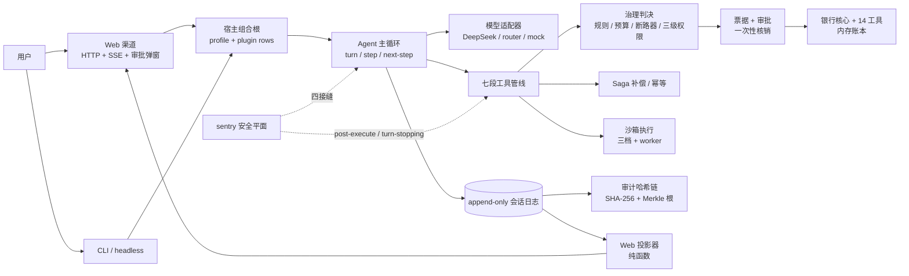

# BAH · 银行智能体

**一个把"模型能做什么"关进可审计边界里的银行智能体演示系统。**

模型只负责理解和表达；能不能执行、执行到什么程度、出事后怎么解释，全部由确定性代码决定。
14 个银行工具、七段工具管线、三级权限、一次性票据、四接缝安全平面、append-only 会话日志与
SHA-256 审计链，构成一条可回放、可核验、可解释的业务链。

> 演示材料里的数字统一取自 [facts.md](facts.md)；架构细节见 [docs/pipeline.md](docs/pipeline.md)、
> [docs/sentry.md](docs/sentry.md)、[docs/audit.md](docs/audit.md)。

---

## 1. 快速开始

环境：Node.js `^22.19 || >=24`，pnpm 10。

```bash
pnpm install
```

| 目的 | 命令 | 说明 |
|---|---|---|
| **起演示** | `pnpm demo:web` | 读 `.env.local` 的 `BAH_MODEL_KEY`，打开 `http://127.0.0.1:7331` |
| **自检** | `pnpm typecheck && pnpm test` | 类型 + 主仓 161 文件 / 1476 用例 |
| **门禁** | `pnpm gate` | 27 项静态与契约检查，任一红即失败 |
| **审计** | `pnpm bah audit --dir <path>` | 离线复验会话日志 + 审计链（`--format json` 出机器可读） |

`.env.local`（不入库）：

```text
BAH_MODEL_KEY=<你的模型密钥>
```

没有密钥也能启动，但第一次调模型会报"未配置密钥"。**断网/离线演示**时，把
`profiles/web/patch.yml` 里 `core:model` 的 `provider: deepseek` / `model: deepseek-v4.1-flash-1017`
两行换成文件里已注释好的 `provider: router` / `model: router-chat`——这是**手动切换**，不是自动降级。

知识检索（可选）：另起 `pnpm rag:dev`（端口 7801）。不起也能跑转账主场景，
知识工具会按 `knowledge-unavailable` fail-closed。

---

## 2. 架构



### 2.1 分层与包职责

| 层 | 包 | 职责 |
|---|---|---|
| 内核 | `packages/core` | Context / 事件（emit、waterfall、serial、parallel）/ 服务注册 / 插件装配 |
| 组合根 | `packages/host` | profile 解析、boot、插件行（渠道、模型、工具、sentry 的接线） |
| 主循环 | `packages/runtime` | turn/step、提示词装配、七段工具管线、会话存储、压缩、恢复 |
| 模型 | `packages/llm` | DeepSeek（OpenAI 兼容协议）、离线意图路由、固定脚本 mock |
| 银行 | `packages/bank` | 内存账本、14 个工具、三级权限升级、票据桥接、强验证状态机 |
| 交互 | `packages/interaction` | 审批仲裁器 + 票据账本（五绑定、一次性核销、过期） |
| 安全 | `packages/safety` | sentry（检测 / 控制 / 票据观测 / 审计 / 幻觉防护 / 断路器）+ 沙箱 |
| 可靠性 | `packages/saga` | 多步配方、补偿、幂等键、审计锚点 |
| 数据 | `packages/persistence` | JSONL 会话、投影、SHA-256 审计链、签名覆盖 |
| 知识 | `packages/knowledge` | RAG 端口、ACL / 时效窗 / 引用校验、知识工具 |
| 渠道 | `packages/channels` | 事件 → Web 帧的纯投影（对话 / 工具卡 / 审批 / DAG / 审计） |
| 前端 | `apps/web` | 原生 ES 模块，无框架、无构建 |
| 命令行 | `packages/cli` | profile bundle、`run` / `audit` / `sentry unfreeze` |
| 评测 | `packages/eval` | M0 判定器、证据与轨迹录制（独立测试配置） |
| 其他 | `packages/memory-store`、`packages/util`、`packages/test-support` | 记忆层内核、零依赖原语、测试夹具 |

### 2.2 一次工具调用的七段

1. `tool/call` 落账；
2. `presentCall(args)` 生成"即将做什么"的卡片（纯函数）；
3. `tools/pre-execute`（**唯一阻断点**）：危险规则 → PII → 预算 → 断路器 → 三级权限；
4. 需要确认时签一次性票据 → `approval/request` → 人点批准/拒绝；
5. `tools/execute` 环绕执行（沙箱 / 超时）；
6. `projectContent` → `tools/post-execute`（脱敏、数值对账、纠正）；
7. 归一化 → `tools/result` → `tool/result` 落账 → 追加纠正上下文 → 卡片。

顺序是冻结契约，不是实现细节；改顺序必须同步文档并重录全部快照。

---

## 3. 算法

### 3.1 三级权限与升级（取高不取低）

- 工具声明下限：`green` 直接执行、`yellow` 必须确认、`red` 强验证 + 确认；
- 转账的动态升级：日累计超限 → 红；新收款人 → 红；组合风险超阈（同 turn 风险调用过多）→ 非绿一律 `ask`；
- 日限额取 `min(卡片限额, Config.dailyTransferLimit)`：**只调 Config 一处，判决与预演展示一起动**；
- 升级只升不降：同一 turn 内已判红，后续不会因为参数变化降回黄。

### 3.2 sentry：检测、控制、对账

- 入口：13 条确定性规则（破坏性命令 / 提权 / 网络外联 / SQL / 越权转账等）+ 分数阈值；
  检测只记分与落审计，**永不直接阻断**；
- 执行前：规则、预算、断路器、只绿降级共同决定 `deny`；
- 结果后：数值对账（声明金额 vs 工具权威金额）不一致 → `block` + 纠正文本；
- 收尾：S-1 行动断言对账——"已完成 / 已转账 / 已核销 / 办理成功 / 已到账"必须与本 turn
  成功的工具结局相符；不符先 `nudge`，同 turn 再犯则判停；
- **fail-closed**：sentry 自己的判决件（post-execute 与 turn-stopping）抛错时，
  一律升级为 block / stop，绝不因为"核验坏了"而放行。

### 3.3 票据：五绑定、一次性、不可预测

票据绑定 `sessionId / tool / 参数指纹 / 金额（分）/ 到期时刻`；ID 是随机 UUID，不由调用 ID 派生。
批准一次性核销；拒绝、过期、无人应答都落 `blocked`。审批 URL 里读到上一张票，猜不出下一张。

### 3.4 Saga、沙箱、审计链

- **Saga**：配方化多步执行（演示主场景是"预检 → 执行"两段 DAG），每步带幂等键与状态机；
  失败按配方补偿，补偿结论落审计，止于"决策 + 人工核销"（银行核心无冲正接口）；
- **沙箱**：`query-only` / `compute-bounded` / `none` 三档；模型生成的代码只能进隔离档，
  一次性 worker + 硬时限 + 堆上限 + 空能力白名单；会话只能收紧档位，放宽必须有人签过的一次性批准；
- **审计链**：`recordHash = sha256(prevHash | canonicalJson(record))`，确定性 canonical JSON；
  支持 Merkle 根与按类型的签名覆盖。**零签名链的报告状态是 `unsigned`，不是 `verified`**。

### 3.5 上下文与知识

- 压缩只折叠**已完整结束**的 turn，当前 turn 永不折叠；金融字段（金额 / 收款人 / 票据）保留结构；
- RAG 检索带 ACL、时效窗、引用与数值校验；sidecar 缺席时知识工具 fail-closed。
  **RAG 响应签名与 TS 验签门（HP-2）未施工**，自评按未施工登记。

---

## 4. 安全

| 机制 | 落点 | 说明 |
|---|---|---|
| 默认拒绝 | 审批 / 强验证 | 无人应答 = `unavailable` = 拒绝；绝不默认放行 |
| fail-closed | sentry 判决件 | 核验异常 → block / stop，错误详情只进审计 |
| PII 脱敏 | 事件与审批帧 | 收款人姓名令牌化（`王**`）、手机号前 3 后 4；业务侧用令牌还原真名 |
| 票据安全 | `packages/interaction` | 五绑定、随机 UUID、一次性核销、过期即拒绝 |
| 沙箱 | `packages/safety` | 模型代码禁入 `none` 档；worker 硬杀；能力白名单恒空 |
| Web 凭证 | `packages/host` | 除健康探针与管理路由外，`/api/*` 要求 Bearer token；SSE 用查询参数 |
| 审计诚实 | `packages/persistence` | 零签名报 `unsigned`；CLI 按"审计未完成"退出码 2 |

**明确不做/未做**（回答追问时照实说）：

- 没有真实登录、多租户、速率限制；Web 鉴权是最小 Bearer token，不是身份系统；
- 银行账本是内存仿真，进程重启回种子；强验证渠道全部是 mock；
- HP-2（RAG 签名）、HP-3（HALT 人工解除）、HP-4（工具出参契约）未施工；
- DAG 规划层未实现，Saga 两步 DAG 是唯一可演示的规划物；
- 卡片挂失/解挂、密码修改未实现；注入检测只记分，不直接阻断。

---

## 5. 14 个工具与权限

| 级别 | 工具 | 说明 |
|---|---|---|
| green | `account_list` `account_balance` `txn_query` `bill_analyze` `bill_report` `analysis_calc` | 只读查询与受限计算，自动执行 |
| green | `transfer_preview` | 转账试算 + 风控预检，不扣款 |
| **yellow** | `transfer_create` | 发起转账；必进审批，超限/新收款人升红 |
| green | `wealth_list` `wealth_compare` | 理财查询与对比（必带风险提示） |
| **red** | `wealth_purchase` | 购买理财：强验证 + 审批 |
| green | `verify_face` `verify_sms` `verify_ushield` | 强验证挑战（`sideEffect: write`，不参与并行读批） |

完整参数、落账事件与生成规则见 [docs/tool-catalog.md](docs/tool-catalog.md)（由 `pnpm tool-catalog` 生成，门禁逐字比对）。

---

## 6. 目录

```text
apps/web/            前端（对话 / 工具卡 / 审批 / DAG / 审计）
packages/            16 个包（见 §2.1）
profiles/            web / headless 装配与 patch
scripts/             27 个 verify-* 门禁、录制、演示脚本
design/bah-ds/       自研设计系统（与应用内分发副本逐字节一致）
docs/                管线、sentry、审计、前端、测试等落地文档
facts.md             演示材料唯一数字来源
```

## 7. 测试与资料

| 命令 | 范围 | 实测（2026-10-23） |
|---|---|---|
| `pnpm test` | 主仓 | 161 文件 / 1476 用例 |
| `pnpm -F @bah/eval test` | 评测包 | 14 文件 / 133 用例 |
| `pnpm test:web` | 前端 | 5 文件 / 47 用例 |
| `pnpm gate` | 门禁 | 27/27 |

三行测试口径**不能相加**：根 vitest 不包含 eval 与 web。更多数字见 [facts.md](facts.md)。

更多材料：[docs/](docs/)；200 字简介见 [docs/简介-200字.md](docs/简介-200字.md)；
演示脚本、安全自评与部署说明见后续交付文档。
