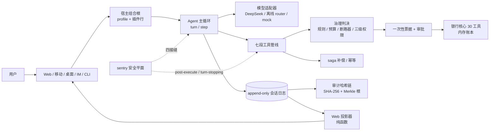

# BAH · 银行智能体

[](LICENSE)
[](https://github.com/YYYPROBEE/BAH/actions/workflows/ci.yml)
[](.nvmrc)

**模型只负责理解和表达；能不能执行、执行到什么程度、出事后怎么解释，由确定性代码决定。**

一个把"模型能做什么"关进可审计边界里的银行智能体底座：插件内核、七段工具管线（唯一阻断点）、
一次性票据、三级权限、DAG 计划编排、saga 补偿、append-only 会话日志与 SHA-256 审计链，
Web / 移动 / 桌面 / IM / CLI 五个壳共用同一套宿主。

<sub>**English** — BAH (Banking Agent Harness) is a Node.js + TypeScript monorepo for bank-facing AI agents.
A cordis-style plugin kernel, a seven-stage tool pipeline with exactly one blocking point, one-shot approval
tickets, three-tier permissions, DAG plan orchestration with resume, saga compensation, and an append-only
session log with a SHA-256 audit chain. The model only understands and speaks; deterministic code decides
what runs. Apache-2.0, docs in Chinese. `pnpm install && pnpm demo:web` gives a full offline demo — no API key.</sub>

---

## 快速开始

环境：Node.js `^22.19 || >=24`，pnpm 10。

```bash
pnpm install
pnpm demo:web        # http://127.0.0.1:7331，离线 router，不需要任何密钥
```

| 目的 | 命令 |
|---|---|
| 移动 H5 | `pnpm bah --profile mobile` → `http://127.0.0.1:7551` |
| 桌面端 | `pnpm build && pnpm desktop:dev`（Electron 内嵌私有 host，断网可用） |
| 容器 | `docker build -t bah:local . && docker run --rm -p 7331:7331 bah:local` |
| 自检 | `pnpm typecheck && pnpm test` |
| 门禁 | `pnpm gate`（`scripts/run-gates.ts` 自动发现全部 `verify-*`，任一红即失败） |
| 审计复验 | `pnpm bah audit --dir <path>`（离线重算会话日志与哈希链，`--format json` 出机器可读） |

主演示默认 `provider: router`：按消息做**离线意图路由**，覆盖余额 / 转账 / 定时转账 / AA / 理财 /
账单 / 卡片 / 订阅 / 资金锁定 / 商户订购 / 生日计划这些演示语法。它**不是自然语言理解**，
认不出就追问，绝不替用户猜金额、收款人或时点。要换成真实模型（DeepSeek 等 OpenAI 兼容端点）见
[docs/llm-endpoints.md](docs/llm-endpoints.md)，那是手动切换，不是自动降级。

知识问答不在 router 范围内，用 `pnpm demo:rag` 一条命令起停 RAG sidecar；sidecar 无 token 拒启，
宿主缺 token 时知识工具按 `knowledge-denied` fail-closed。

---

## 架构



| 层 | 包 | 职责 |
|---|---|---|
| 内核 | `packages/core` | Context / 事件（emit、waterfall、serial、parallel）/ 服务注册 / 插件装配 |
| 组合根 | `packages/host` | profile 解析、boot、插件行（渠道、模型、工具、sentry 的接线） |
| 主循环 | `packages/runtime` | turn/step、提示词装配、工具管线、会话存储、压缩、恢复 |
| 银行 | `packages/bank` | 内存账本、30 个工具、三级权限升级、票据桥接、强验证状态机 |
| 安全 | `packages/safety` | sentry（检测 / 控制 / 审计 / 幻觉防护 / 断路器）+ 沙箱 |
| 可靠性 | `packages/saga` | 多步配方、补偿、幂等键、审计锚点 |

其余 12 个包（`llm` `policy` `interaction` `persistence` `knowledge` `channels` `cli` `eval`
`memory-store` `util` `test-support` 与 `apps/web`）的分工见 [docs/architecture.md](docs/architecture.md)。

**一次工具调用的七段**：`tool/call` 落账 → 生成"即将做什么"卡片 → `tools/pre-execute`（**唯一阻断点**：
危险规则 → PII → 预算 → 断路器 → 三级权限）→ 签一次性票据 / 审批 → `tools/execute`（沙箱 / 超时）→
`post-execute`（脱敏、数值对账、纠正）→ `tools/result` 落账并追加纠正上下文。顺序是冻结契约，
改顺序必须同步文档并重录全部快照。

---

## 关键设计

- **三级权限只升不降**：`green` 直接执行、`yellow` 必须确认、`red` 强验证 + 确认；日累计超限、新收款人、
  同 turn 风险调用过多都会把转账升红，且同 turn 内已判红不会降回黄。规则已文件化到
  `policies/bank-tier/1.0.0`（决策表 + 内容寻址），详见 [docs/policy.md](docs/policy.md)。
- **票据五绑定、一次性**：绑定 `sessionId / tool / 参数指纹 / 金额（分）/ 到期时刻`，ID 是随机 UUID；
  拒绝、过期、无人应答一律落 `blocked`，**默认失败**而不是默认放行。
- **sentry fail-closed**：13 条确定性规则只记分与落审计、永不直接阻断；真正拦截在执行前的
  `deny` 与执行后的数值对账。sentry 自己的判决件抛错时一律升级为 block / stop。
- **审计诚实**：`recordHash = sha256(prevHash | canonicalJson(record))`；**零签名链的报告状态是
  `unsigned`，不是 `verified`**，CLI 按"审计未完成"退出。
- **编排两层**：`plan:dag` 接外部计划做校验 + 拓扑执行 + 断点续跑；saga 是"一笔业务的前向步骤 + 补偿"。
  plan 编排 saga，但 plan 节点写操作的补偿**未做**，动态 args 也跨不了 `resume`——如实登记在
  [docs/security-design.md](docs/security-design.md) §4。

## 安全边界（如实说明）

| 机制 | 说明 |
|---|---|
| 默认拒绝 | 无人应答 = `unavailable` = 拒绝；HALT 状态下新 turn / 新工具调用 / 新 plan 节点三处全拒 |
| fail-closed | 核验异常一律 block / stop，错误详情只进审计 |
| PII 脱敏 | 收款人姓名令牌化（`王**`）、手机号前 3 后 4；业务侧用令牌还原真名 |
| 沙箱 | `query-only` / `compute-bounded` / `none` 三档，模型代码禁入 `none`；一次性 worker + 硬时限 + 空能力白名单。逻辑隔离，**不是 OS / 容器隔离** |
| Web 凭证 | `none` / `static`（客户 + 坐席双 token）/ `password`（scrypt + HttpOnly 会话 + 撤销）；写请求另需同源 Origin 或 CSRF double-submit |
| 租户边界 | 租户 = 部署边界（ADR-0004）：会话 / 审计 / 记忆 / HALT 全按 `<root>/<tenant>/` 分区；一进程 N 租户**不做** |

**明确不做 / 已知缺口**：银行账本是内存仿真（重启回种子）；强验证默认是测试网关适配器，未接真实
短信 / 人脸 / U 盾；RAG 条目级验签已落地，**响应信封签名未做**；记忆层影子核验未接（`bankQuery` 是占位）；
对抗集幻觉族有 2 条未降级。逐条取舍见 [docs/security-design.md](docs/security-design.md)，
漏洞披露走 [SECURITY.md](SECURITY.md)。

---

## 工具、目录与测试

30 个银行工具（14 绿 / 10 黄 / 6 红），参数、落账事件与生成规则见
[docs/tool-catalog.md](docs/tool-catalog.md)（由 `pnpm tool-catalog` 生成，门禁逐字比对）。

```text
apps/web/        前端（对话 / 工具卡 / 审批 / DAG / 审计），原生 ES 模块，无框架无构建
packages/        18 个包（见 §架构）
profiles/        9 个装配 profile（web / web-plan / mobile / desktop / im / headless / plan / sdk / subscription）
scripts/         门禁 verify-*、录制、演示脚本
design/bah-ds/   自研设计系统
docs/            管线、sentry、审计、策略、前端、部署等落地文档
facts.md         演示材料唯一数字来源
```

实测（2026-11-03）：`pnpm test` 455 文件 / 5283 用例；`pnpm test:web` 610 用例；`pnpm eval:unit` 158 用例；
`pnpm test:snapshot` 60 例；`pnpm gate` 全绿；行覆盖 98.32%。**三行测试数不能相加**，取值命令与原始输出
见 [facts.md](facts.md) 与 [docs/facts-sources.md](docs/facts-sources.md)。

## 更多文档

[docs/](docs/) 为入口：管线 [docs/pipeline.md](docs/pipeline.md)、sentry [docs/sentry.md](docs/sentry.md)、
审计 [docs/audit.md](docs/audit.md)、计划编排 [docs/plan.md](docs/plan.md)、
部署 [docs/deploy.md](docs/deploy.md)、测试 [docs/testing.md](docs/testing.md)、
200 字简介 [docs/简介-200字.md](docs/简介-200字.md)。

## 参与贡献

先读 [CONTRIBUTING.md](CONTRIBUTING.md)。本项目只接受**可复现的证据**：改行为要带用例，改契约要同步
`docs/contracts/`，改装配要重录快照。安全问题不要开公开 issue，走 [SECURITY.md](SECURITY.md) 的私密通道。
参与即表示同意 [CODE_OF_CONDUCT.md](CODE_OF_CONDUCT.md)。

## 许可

[Apache License 2.0](LICENSE)：可商用、可修改、可再分发，保留版权、许可与 [NOTICE.md](NOTICE.md) 中的
来源声明。第三方组件与机制借鉴逐项登记在 [NOTICE.md](NOTICE.md)。

本工程最初为银行 AI 智能体赛题而建，部分 ADR 里的「赛题 §x」指当时任务书的章节号；赛程结束后
`main` 即唯一开发线。
