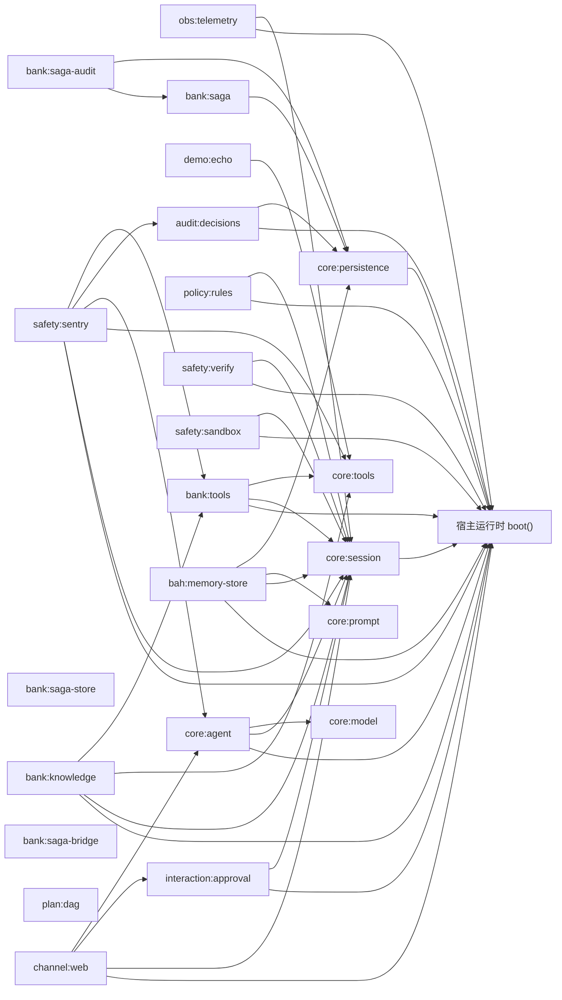
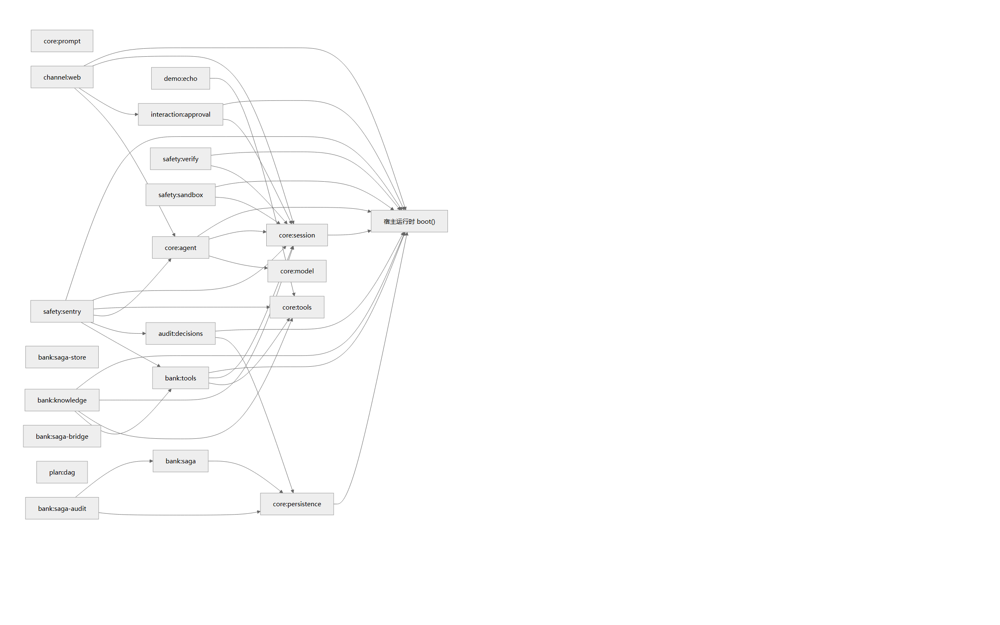
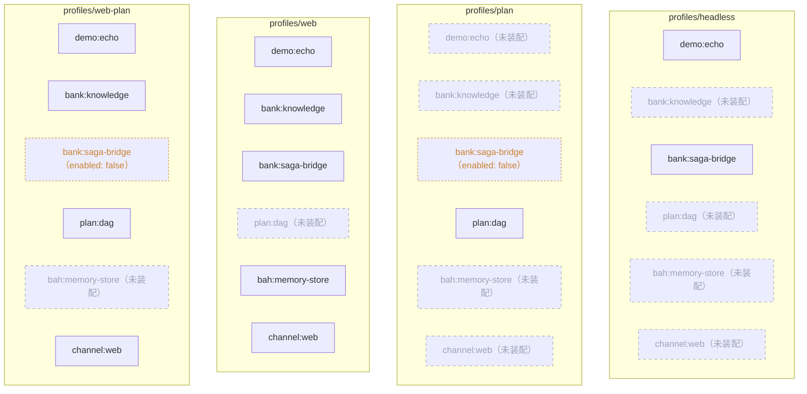
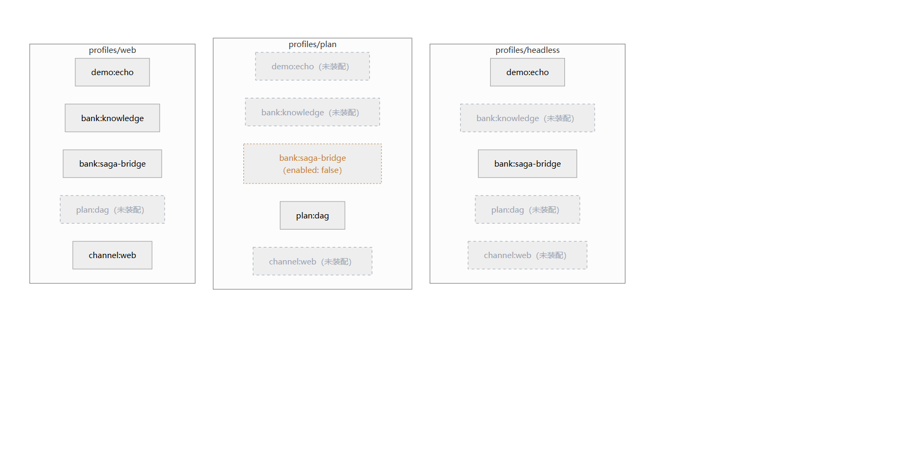

# 架构：注册表、装配与数据流

> W19 交付件之一。**本文的图与事实表由脚本生成**（`scripts/gen-architecture.ts`），
> 块外文字手写；生成块过期会让门禁 `verify-architecture` 直接红。
> 配套两份：[algorithms.md](algorithms.md)（三条核心算法）、[security-design.md](security-design.md)（威胁模型与缺口）。
>
> 本文不重复各包的机制细节——每种机制都有唯一的说明书（`docs/plan.md`、`docs/sentry.md`、
> `docs/pipeline.md`、`docs/knowledge.md`、`docs/audit.md`），本文只负责**把组件摆到正确的位置上**。

## 1. 两张面，两个问题

架构图最容易被问倒的不是"你有哪些组件"，而是**"这个组件在哪个入口生效"**。
所以这里刻意分成两面，每面用"能说清的那张载体"（图或表）来表达：

| 面 | 回答的问题 | 载体 | 数据来源 |
|---|---|---|---|
| **组件与依赖** | "系统由哪些部件组成、谁依赖谁" | 分层表 + 依赖图 + 依赖明细表 | `HOST_PLUGINS` + 每个插件的 `inject` |
| **装配** | "**这个 profile** 到底装了哪些" | 差异图 + 20×3 矩阵 | 真实装载器：`readProfile` → `loadBundles` → `readLayers` → `mergeLayers` |

### 1.1 三种状态，不是两种

施工单 v2 只写了"装配 / 未装配"两态，实测必须三态——否则会把"装了但关掉"讲成"没装"：

| 态 | 判据 | 画法 | 例子 |
|---|---|---|---|
| **生效** | 该 profile 有这一行，且 config 没有 `enabled: false` | 实线 | `core:session` 在三个 profile 都生效 |
| **装配但关闭** | 有行，但 `enabled: false`（插件 `apply()` 里直接 `return`） | 虚线 + 标注 | `bank:saga-bridge` 在 `profiles/plan` 里 |
| **未装配** | 该 profile 根本没有这一行（注册表里有，但没人 `use`） | 不画；在别的 profile 里画灰虚线 | `channel:web` 只在 `profiles/web` |

`enabled: false` 的区别是真金白银的：`bank:saga-bridge` 关掉时，它的 tick 定时器、补偿依赖
全都不接管，但插件实例仍在（`ctx.get` 得到的是"什么都不做"的实现）。把它画成"没装"，
答辩时被问"那 plan 里的转账谁补偿"就会答错——正确答案是**没有补偿，只有前向执行**，
要补偿得让 plan 去编排一整笔 saga。

## 2. 事实表（三份文档共用同一块）

> 下面这张表由脚本注入到 `architecture.md` / `algorithms.md` / `security-design.md`
> **同一个块**——三份文档对同一批事实只可能有一种说法。

<!-- BEGIN GENERATED:facts -->
| 事实 | 值 | 唯一来源（以代码为准，改文档不改代码） |
|---|---|---|
| plan 节点态 | **9 态**（pending、ready、running、succeeded、failed、skipped、blocked、cancelled、incident） | packages/runtime/src/plan/types.ts 的 `PLAN_NODE_STATES` |
| saga 状态 | **11 态**（CREATED、RUNNING、PENDING_RISK_REVIEW、GATE_HOLDING、COMPENSATING、PARTIALLY_COMPENSATED、COMPENSATION_DLQ、SUCCEEDED、ABORTED_CLEAN、COMPENSATED、MANUALLY_CLOSED） | packages/saga/src/state-machine/transitions.ts 的 `SAGA_TRANSITIONS` |
| 票据 TTL / 计划预算 | **120000 ms / 30000 ms**（预算 < TTL） | `PlanSettings.ticketTtlMs` / `planTimeoutMs`（本行由 planPlugin.validate 实算） |
| 工具数 | **16 个** | packages/bank/src/tools/specs.ts 的 `BANK_TOOL_SPECS` |
| 注册表 / 门禁 | **23 项 / 43 项** | `HOST_PLUGINS`、`scripts/verify-*.ts` 计数 |
| 覆盖率 | **91.14%（行口径，31233/34270 行，实测 2026-10-28）；15/16（包口径：包级行覆盖 ≥80% 的包数 / 参与统计的包数）** | docs/coverage-baseline.json（含测量命令） |
<!-- END GENERATED:facts -->

## 3. 组件与依赖（20 个组件）

### 3.0 分层

按 id 前缀归层。**分层用表格不用图**：mermaid 对"8 个分组 × 20 个节点、组间无连线"这种输入
没有稳定布局（实测要么横排到画布外，要么每组自成一列），而分层本身是**分类信息**，
表格比图准、也比图好核对。

<!-- BEGIN GENERATED:layers -->
| 层 | 组件 | 数量 |
|---|---|---|
| ① 内核与主循环（core） | `core:session`、`core:tools`、`core:prompt`、`core:model`、`core:agent`、`core:persistence` | 6 |
| ② 证据链（audit） | `audit:decisions` | 1 |
| ③ 银行域（bank） | `bank:tools`、`bank:knowledge`、`bank:saga-store`、`bank:saga`、`bank:saga-audit`、`bank:saga-bridge` | 6 |
| ④ 交互与审批（interaction） | `interaction:approval` | 1 |
| ⑤ 安全防护（safety） | `safety:sentry`、`safety:verify`、`safety:sandbox` | 3 |
| ⑥ 编排原语（plan） | `plan:dag` | 1 |
| ⑦ 渠道（channel） | `channel:web` | 1 |
| ⑧ 演示件（demo） | `demo:echo` | 1 |
| **合计** | — | **23** |
<!-- END GENERATED:layers -->

### 3.1 依赖图（谁向谁要服务）

<!-- BEGIN GENERATED:dependency-graph -->

<!-- END GENERATED:dependency-graph -->

读图要点：`core:agent` 依赖 `bah:run`（注入钟/会话 ID）、`runtime:session`、`llm:adapters`；
`safety:sentry` 是依赖最多的一个（6 个），因为它站在四个接缝上，既是观察者又是阻断者；
`channel:web` 只依赖运行时与审批服务——它**不认识**银行域，这是渠道可替换的前提。

图上只画箭头不带标签（8 条同名 `bah:run` 会糊成一片），**具体依赖哪个服务看这张表**：



<!-- BEGIN GENERATED:dependencies -->
| 组件 | 依赖的服务（`inject`） | 提供方 |
|---|---|---|
| core:session | `bah:run` | 宿主运行时 boot() |
| obs:telemetry | `bah:run`、`runtime:session` | 宿主运行时 boot()、`core:session` |
| core:tools | —（无依赖） | — |
| core:prompt | —（无依赖） | — |
| core:model | —（无依赖） | — |
| core:agent | `bah:run`、`runtime:session`、`llm:adapters` | 宿主运行时 boot()、`core:session`、`core:model` |
| core:persistence | `bah:run` | 宿主运行时 boot() |
| audit:decisions | `bah:run`、`bah:session-files` | 宿主运行时 boot()、`core:persistence` |
| demo:echo | `runtime:tools` | `core:tools` |
| bank:tools | `bah:run`、`runtime:session`、`runtime:tools` | 宿主运行时 boot()、`core:session`、`core:tools` |
| policy:rules | `bah:run`、`runtime:session` | 宿主运行时 boot()、`core:session` |
| bank:knowledge | `bah:run`、`runtime:tools`、`runtime:session`、`bank:identity` | 宿主运行时 boot()、`core:tools`、`core:session`、`bank:tools` |
| interaction:approval | `bah:run`、`runtime:session` | 宿主运行时 boot()、`core:session` |
| safety:sentry | `bah:run`、`runtime:session`、`runtime:tools`、`runtime:agents`、`bank:ticket-guard`、`audit:decisions` | 宿主运行时 boot()、`core:session`、`core:tools`、`core:agent`、`bank:tools`、`audit:decisions` |
| safety:verify | `bah:run`、`runtime:session` | 宿主运行时 boot()、`core:session` |
| safety:sandbox | `bah:run`、`runtime:session` | 宿主运行时 boot()、`core:session` |
| bank:saga-store | —（无依赖） | — |
| bank:saga | `bah:session-files` | `core:persistence` |
| bank:saga-audit | `bah:saga-clock`、`bah:session-files` | `bank:saga`、`core:persistence` |
| bank:saga-bridge | —（无依赖） | — |
| plan:dag | —（无依赖） | — |
| bah:memory-store | `bah:run`、`runtime:session`、`runtime:system-prompt`、`bah:session-files` | 宿主运行时 boot()、`core:session`、`core:prompt`、`core:persistence` |
| channel:web | `bah:run`、`runtime:session`、`runtime:agents`、`interaction:approval` | 宿主运行时 boot()、`core:session`、`core:agent`、`interaction:approval` |
<!-- END GENERATED:dependencies -->

## 4. 装配图与矩阵（三个可运行 profile）

`profiles/` 下有 7 个目录，但只有 `headless` / `plan` / `web` 有 `profile.yml`，
其余四个是空壳。差异的本质：

<!-- BEGIN GENERATED:assembly -->

<!-- END GENERATED:assembly -->



图中：实线 = 生效；灰虚线 = 该 profile 未装配（别的 profile 装了）；橙色虚线 = 装配但
`enabled: false`。**只画三个 profile 状态不一致的组件**，一致的组件见下面的矩阵表。

同一份数据的表格视图（答辩时按行念更清楚）：

<!-- BEGIN GENERATED:matrix -->
| 组件 | profiles/headless | profiles/plan | profiles/web | profiles/web-plan |
|---|---|---|---|---|
| core:session | ● 生效 | ● 生效 | ● 生效 | ● 生效 |
| obs:telemetry | ● 生效 | ● 生效 | ● 生效 | ● 生效 |
| core:tools | ● 生效 | ● 生效 | ● 生效 | ● 生效 |
| core:prompt | ● 生效 | ● 生效 | ● 生效 | ● 生效 |
| core:model | ● 生效 | ● 生效 | ● 生效 | ● 生效 |
| core:agent | ● 生效 | ● 生效 | ● 生效 | ● 生效 |
| core:persistence | ● 生效 | ● 生效 | ● 生效 | ● 生效 |
| audit:decisions | ● 生效 | ● 生效 | ● 生效 | ● 生效 |
| demo:echo | ● 生效 | · 未装配 | ● 生效 | ● 生效 |
| bank:tools | ● 生效 | ● 生效 | ● 生效 | ● 生效 |
| policy:rules | ● 生效 | ● 生效 | ● 生效 | ● 生效 |
| bank:knowledge | · 未装配 | · 未装配 | ● 生效 | ● 生效 |
| interaction:approval | ● 生效 | ● 生效 | ● 生效 | ● 生效 |
| safety:sentry | ● 生效 | ● 生效 | ● 生效 | ● 生效 |
| safety:verify | ● 生效 | ● 生效 | ● 生效 | ● 生效 |
| safety:sandbox | ● 生效 | ● 生效 | ● 生效 | ● 生效 |
| bank:saga-store | ● 生效 | ● 生效 | ● 生效 | ● 生效 |
| bank:saga | ● 生效 | ● 生效 | ● 生效 | ● 生效 |
| bank:saga-audit | ● 生效 | ● 生效 | ● 生效 | ● 生效 |
| bank:saga-bridge | ● 生效 | ○ 关闭 | ● 生效 | ○ 关闭 |
| plan:dag | · 未装配 | ● 生效 | · 未装配 | ● 生效 |
| bah:memory-store | · 未装配 | · 未装配 | ● 生效 | · 未装配 |
| channel:web | · 未装配 | · 未装配 | ● 生效 | ● 生效 |
<!-- END GENERATED:matrix -->

### 4.1 六处差异的**理由**（不是随手配的）

| 差异 | 为什么 |
|---|---|
| `channel:web` 只在 web / web-plan | 渠道是入口，headless/plan 不需要 HTTP 端口；装上会白占端口并让 `main.smoke` 撞端口 |
| `plan:dag` 在 plan 与 web-plan | 默认 web **不装** plan——不让主演示路径的模型自己画 DAG；要演示"模型可见的规划 + DAG 节点图"用 `web-plan`（B1/B2）：`modelTools: true` 显式打开，且 saga-bridge 显式关闭 |
| `bank:knowledge` 只在 web / web-plan | 它要 `mode: http` 连 RAG sidecar；headless/plan 不联网、零依赖是硬约束 |
| `bank:saga-bridge` 在 plan / web-plan 关闭 | 否则 `transfer_create` 被再展开成一笔 saga，一条 `plan/node-result` 会对上两条 `tool/call`，plan 的计数断言全部失真 |
| `interaction:approval.responder` | headless/plan 用自动应答者（无人值守），web/web-plan 用 `none` + 真人点——**默认结论都是拒绝**，绝不默认放行 |
| `bah:memory-store` 只在 web | 记忆会改变模型输入，不做静默开启；由 web profile 显式写（单租户 demo，诚实边界见插件注释） |

## 5. 一次 Web 对话的路径（数据流）

```text
POST /api/turn
  └─ channel:web  handlers/session.handleTurn   验票(401/403) → agent.send(text) → ensureDriver
       └─ core:agent  drive()                    turn/start → step/start
            ├─ agent/pre-step   safety:sentry   归一化 6 步 + 9 签名检测 + 风险分（永不拒绝）
            ├─ core:model                        llm/stream（chrome 上的 ephemeral delta）
            ├─ assistant/message                 ← 工具调用意图
            ├─ tools/pre-execute
            │    ├─ bank:tools                  五级权限判定 → 签票据（黄/红）
            │    ├─ safety:sentry               危险规则/预算/熔断 → deny | ask | allow
            │    └─ interaction:approval         ask ⇒ approval/asked + ticket/issued
            │         └─ channel:web 的应答者    真人点"批准" → allowed-once → ticket 可核销
            ├─ tools/execute  ToolPipeline      七段管线；转账前核销票据（一次性）
            └─ tool/result                       ← 权威结果（唯一面向模型的结果）
       └─ session.append(...)                    每条事件都过这里
            ├─ core:persistence                  session.jsonl（durable，按落账顺序）
            ├─ audit:decisions                   audit.jsonl（判决链，W08）
            ├─ safety:sentry                     TraceLog（sentry/trace，ignorable）
            └─ channel:web 的投影器               事件 → 帧 → SSE
```

两个容易被忽略但**必须讲**的点：

- **落账是单点**：所有事件（含领域事件）都过 `runtime:session`，磁盘顺序 = 广播顺序
  （W18 修的就是这条：嵌套 append 曾经让排在后面的监听器先收到 N+1）；
- **工具结果只有一份**：`tool/result` 既是落账事实，也是模型能看到的唯一结果；
  卡片、DAG、审计时间线都是它的**投影**，不是第二份真相。

## 6. 怎么改架构图（以及它为什么不会腐烂）

```bash
npx tsx scripts/gen-architecture.ts           # 重写生成块
npx tsx scripts/gen-architecture.ts --check   # 只校验（门禁与 CI 用这条）

# PNG（进 PPT / 给不渲染 mermaid 的读者）：需要一次性准备渲染器
curl -sSL -o .tmp-w19/mermaid.min.js https://unpkg.com/mermaid@11/dist/mermaid.min.js
MERMAID_JS=.tmp-w19/mermaid.min.js npx tsx scripts/render-diagrams.ts
```

- 组件名只能来自 `HOST_PLUGINS`，脚本里**没有一个**组件名字面量；
- 装配状态只能来自真实装载器，不自己解析 YAML；
- 事实表的数值来自 `PLAN_NODE_STATES` / `SAGA_TRANSITIONS` / `BANK_TOOL_SPECS` /
  `planPlugin.validate()` / `scripts/verify-*.ts` 计数——全是运行时真值；
- 唯一"跑一遍才有"的事实是覆盖率，它落在 `docs/coverage-baseline.json`（带测量命令与日期），
  改它必须是一次真实测量。

## 7. 已知限制（架构层面的，不是缺陷清单）

1. **依赖图不表达"同一插件多实例"**：脚本遇到一个插件被两行引用会直接抛错，
   而不是画一张含糊的图。当前没有这种用法，将来要有，先决定图的表达方式。
2. **装配图不表达层序**：`mergeLayers` 的四层（bundle → profile patch → home → overlay）
   在图上被压成了一个结果。层序本身在 `docs/profile.md`，这里不重复。
3. **依赖边只到"服务键"粒度**：`inject` 是服务级契约，不是函数调用图。
   想看函数级调用请直接读包的 `index.ts`。
   **懒取的服务不是 `inject` 边，图里不画**：`safety:halt` 与
   `runtime:context-source`（实体槽位数据源，由 `bank:tools` 提供、`core:agent`
   每 step 懒取）都属这一类。它们的存在由对应插件/端口文档说明；
   `SERVICE_OWNER` 只服务 `inject` 解析，不是全量服务清单。
4. **部署拓扑只有一条**：单进程、无外部中间件（除可选的 RAG sidecar）。
   "多租户"在这条拓扑上是**多个这样的进程**并存，不是一进程多租户——见 §8。

## 8. 租户边界（部署拓扑）

> 决策与被否掉的替代方案见 `docs/adr/0004-tenant-as-deployment-boundary.md`；
> 契约（标识、主体、隔离边界表）见 `docs/contracts/tenant-model.md`。
> 本节只讲**装配**上看得见的东西。

**租户 = 部署边界**：一个进程只服务一个租户。多租户 = 同一台机器上 N 个进程，
靠"目录 / 端口 / 令牌 / 密钥"四道物理隔离分开。这不是省事：
`Context.isolate()` 只做键屏蔽、事件总线是全进程共享、`runtime:session` 是单例，
所以"一进程多租户"在本仓的装配图上**画不出来**（画出来就是错的）。

### 8.1 六个注入点（每个平面唯一）

| 平面 | 注入点 | 装配位置 |
|---|---|---|
| 会话目录 | `RunContext.tenantId` → `SessionFiles.root` | `packages/host/src/boot/plugins/persistence.ts` |
| 记忆库 | `RunContext.tenantId`（配置键 `tenant` 已删） | `packages/host/src/boot/plugins/memory.ts` |
| 审计链 | 链句柄的 `tenant`（建链时给一次） | `packages/host/src/boot/plugins/audit-decisions.ts` |
| 指标 | `WebDeps.tenantId` | `packages/host/src/boot/plugins/web.ts` |
| 知识库令牌 | `BAH_KNOWLEDGE_TOKEN_<TENANT>`（回退共享令牌仅 demo） | `packages/host/src/boot/plugins/knowledge.ts` |
| 仿真数据集 | `tenantSaltOf(tenantId)`（demo 零偏移） | `packages/bank/src/forge/index.ts` |

租户来自**启动输入**（`--tenant` > `BAH_TENANT` > `demo`），不来自请求。
`scripts/verify-tenant-scope.ts` 的判据 3 机械检查"没有哪条路径从请求里取租户"。

### 8.2 目录布局（一条命令列全）

```
<config.root>/                 ← 部署根（core:persistence.root 或 --jsonl）
  <tenant>/                    ← 租户根（SessionFiles.root）
    <sessionId>/session.jsonl
    <sessionId>/audit.jsonl
    memory.db
    halt.json
    anchors.json
    saga-<uuid>/audit.jsonl
  saga.sqlite                  ← 部署根上：saga 库**不按租户分库**（01 §5 的裁剪决策）
```

判据只有一句：**能不能用一条命令把这个租户的全部持久痕迹列出来**。
`ls <config.root>/<tenant>` 就是答案。

### 8.3 三个"看起来可以、实际不行"的做法

1. **按请求头分租户**：内核没有事件作用域，两个租户会互相收到 `session/event`；
   而且没有任何门禁能证明它错了（`isolate` 的断言钉死了事件总线是同一个）。
2. **只给会话目录加租户段、忘给审计链加**：`chainIds(root)` 只扫一层，
   漏拼之后"扫不到 = 没问题"，断链检测静默失效（AR-01 的形态）。
3. **让每个插件自己拼 `<root>/<tenant>/...`**：同一件事有五处实现，
   至少一处会漏（这就是 `tenantRootOf` 存在的理由）。
